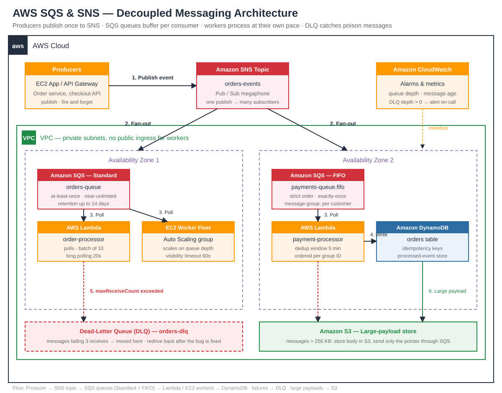

# AWS SQS & SNS Messaging Guide — Decouple Everything, Lose Nothing


> **TL;DR** — SQS is the queue, SNS is the megaphone. Together they let your services talk without ever waiting on each other: SNS fans a message out to many subscribers, SQS holds each copy until a worker is ready to process it. Master delivery modes, FIFO ordering, dead-letter queues and visibility timeouts — and your system survives traffic spikes, slow consumers and crashed workers without losing a single message.

---

## 🗺️ Architecture



The diagram shows a complete production messaging setup: producers publish to an **SNS topic**, which fans out to **SQS queues** (standard + FIFO) across two AZs. **Lambda** and **EC2 workers** consume at their own pace, failed messages land in a **dead-letter queue (DLQ)**, and **CloudWatch** alarms on queue depth and message age.

---

## 🧭 SQS vs SNS — the full comparison

| | **Amazon SQS** | **Amazon SNS** |
|---|---|---|
| **Pattern** | Pull — workers poll the queue | Push — topic pushes to subscribers |
| **Model** | One message → one consumer | One message → many subscribers |
| **Analogy** | A mailbox you check when ready | A megaphone that shouts to everyone |
| **Ordering** | FIFO queues: strict, exactly-once | FIFO topics: ordered per message group |
| **Retention** | Up to 14 days | No storage — delivery is instant or lost |
| **Best for** | Work queues, buffering, throttling | Notifications, fan-out, event broadcast |
| **Combine them** | **SNS → SQS fan-out:** one publish, N queues each get a copy | |

---

## ⚖️ Standard vs FIFO — choose deliberately

| | Standard queue | FIFO queue |
|---|---|---|
| **Throughput** | Nearly unlimited | 3,000 msg/s (batching) / 300 msg/s (single) |
| **Ordering** | Best-effort (messages can arrive out of order) | Strict, per message-group ID |
| **Delivery** | At-least-once (duplicates possible) | Exactly-once (5-min dedup window) |
| **Name suffix** | `orders` | `orders.fifo` |
| **Use when** | Order doesn't matter, scale matters | Payments, ledger updates, exactly-once matters |

**Rule of thumb:** default to Standard. Reach for FIFO only when a duplicate or a reorder would cost real money.

---

## 🧯 Dead-letter queues — your safety net

- A message that fails processing **N times** (e.g. `maxReceiveCount: 3`) is moved to the DLQ automatically — it never blocks the queue forever.
- **Poison messages** (a payload that always crashes your worker) are the #1 cause of stuck queues. Without a DLQ, one bad message can wedge the whole pipeline.
- Set a **redrive policy** (`redrive_allow_policy`) so you can replay DLQ messages back to the source queue after fixing the bug — no data loss, no manual re-queueing.
- Alarm on `ApproximateNumberOfMessagesVisible` in the DLQ: **any message there means something is wrong.**

---

## ⏱️ Visibility timeout — the lease, not a lock

- When a worker receives a message, it becomes **invisible** to other workers for the visibility timeout (default 30s).
- If the worker finishes in time, it **deletes** the message. If it crashes or runs long, the message **reappears** and another worker picks it up.
- **Golden rule:** visibility timeout > your longest normal processing time. Too short → duplicate processing. Too long → slow recovery from crashed workers.
- Long-running job? Call `ChangeMessageVisibility` to **extend the lease** while you work.

---

## 🧑‍💻 Code — fan-out + worker in one file

See [`messaging.py`](messaging.py) — a runnable demo that:

1. Creates an SNS topic and two SQS queues (one standard, one FIFO).
2. Publishes one order event — SNS fans it out to **both** queues.
3. Runs a worker loop with visibility-timeout handling and DLQ redrive.
4. Works **offline** with a built-in simulator when no AWS credentials are present.

```bash
python messaging.py            # offline simulator demo
python messaging.py --live     # real AWS (needs boto3 + credentials)
```

```python
# The core idea in 6 lines (see messaging.py for the full demo)
sns.publish(TopicArn=topic_arn, Message=json.dumps(order))
msgs = sqs.receive_message(QueueUrl=queue_url, MaxNumberOfMessages=10)
for m in msgs:
    process(m["Body"])
    sqs.delete_message(QueueUrl=queue_url, ReceiptHandle=m["ReceiptHandle"])
```

---

## ✅ Production checklist

- [ ] DLQ configured on **every** queue (`maxReceiveCount` ≤ 5)
- [ ] Visibility timeout > p99 processing time
- [ ] Alarms: queue depth, oldest-message age, DLQ depth > 0
- [ ] FIFO only where ordering/dedup is a real requirement
- [ ] Message size ≤ 256 KB (larger payloads → S3 pointer pattern)
- [ ] Encryption at rest (SSE-SQS or KMS) + least-privilege IAM per queue
- [ ] Batching (`MaxNumberOfMessages=10`) + long polling (`WaitTimeSeconds=20`) to cut cost

---

## 🧠 Quiz teaser

Can a standard SQS queue guarantee your messages arrive in order? What happens to a message when its worker crashes mid-processing? Test yourself in [`quiz.md`](quiz.md) — 5 questions, answers collapsed.

---

## 🔗 Keep learning

- [AWS SQS Developer Guide](https://docs.aws.amazon.com/AWSSimpleQueueService/latest/SQSDeveloperGuide/welcome.html)
- [AWS SNS Developer Guide](https://docs.aws.amazon.com/sns/latest/dg/welcome.html)
- [Amazon SQS FIFO queues](https://docs.aws.amazon.com/AWSSimpleQueueService/latest/SQSDeveloperGuide/FIFO-queues.html)
- [Dead-letter queues](https://docs.aws.amazon.com/AWSSimpleQueueService/latest/SQSDeveloperGuide/sqs-dead-letter-queues.html)

---

*Part of the daily cloud engineering series — one standalone guide per day. Previous: [aws-route53-dns-guide](https://github.com/sepkascurty-cpu/aws-route53-dns-guide).*
